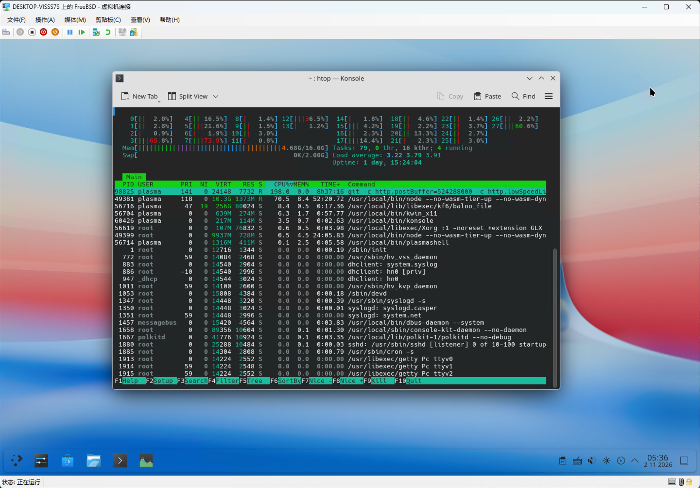

# hypervgfx — Hyper-V Synthetic Video Driver for FreeBSD

A display driver that lets a FreeBSD guest use the Hyper-V synthetic
video device (SYNTHVID), showing the KDE Plasma desktop directly in the
host's Hyper-V console (vmconnect) — no more xf86-video-dummy + x11vnc
workarounds.

*[中文说明](README.zh-CN.md)*



The screenshot shows the Virtual Machine Connection window of a
Windows 11 host, displaying the desktop of a FreeBSD 15.1 VM running
hypervgfx (1440x900).

## Features

- Binds the vmbus synthetic video device (`HV_SYNTHVID_GUID`) and
  implements the full SYNTHVID protocol (version negotiation, VRAM
  location, situation updates, resolution query, damage/dirt
  notifications, pointer hiding)
- **Guest-driven resolution switching**: a `SITUATION_UPDATE` makes the
  host reconfigure the virtual monitor. All 13 host-reported modes are
  usable (640x480 – 1920x1080, limited by the 8 MB framebuffer window;
  1920x1080 is the largest mode that fits)
- fbdev frontend: registers `/dev/fb0`; Xorg renders through the
  `xf86-video-scfb` driver directly into the framebuffer
- Console integration: vt automatically switches from efifb to the
  generic fb backend, so the text console and X share one framebuffer
- Periodic full-screen DIRT refresh keeps the display live (rate is
  tunable or can be disabled)

## How it works

```
KDE Plasma / Xorg (xf86-video-scfb)
    |  /dev/fb0 (fbd + fb_info)
    v
hypervgfx.ko  -- vt console (same framebuffer)
    |  SYNTHVID protocol v3.5 (vmbus channel)
    v
Hyper-V host ---> Hyper-V console window (vmconnect)
```

The VRAM is the framebuffer window Hyper-V reserves in the guest
physical address space (the EFI GOP framebuffer on Gen2 VMs — 8 MB at
0xf8000000 on our test machine). The driver hands the window's GPA to
the host with a `VRAM_LOCATION` message; from then on the host
interprets the framebuffer using the geometry from
`SITUATION_UPDATE` and repaints the regions named in `DIRT` messages.

## Building

```sh
cd hypervgfx
make            # produces hypervgfx.ko
```

Requires the kernel source tree (`/usr/src/sys`, FreeBSD 15.x).
The driver depends on the in-kernel `vmbus` (part of Hyper-V support).

## Installation and configuration

```sh
cp hypervgfx.ko /boot/modules/
```

`/boot/loader.conf`:

```sh
hw.hypervgfx.mode="1440x900"   # mode to switch to at attach (optional)
```

`/etc/rc.conf`:

```sh
kld_list="${kld_list} hypervgfx"
```

Xorg (`/usr/local/etc/X11/xorg.conf.d/20-hypervgfx-scfb.conf`):
use `Driver "scfb"` for the Device, and keep the Screen Modes/Virtual
in sync with `hw.hypervgfx.mode` (scfb only learns the framebuffer
geometry at X startup).

## Runtime control (sysctl)

| Node | Description |
|---|---|
| `hw.hypervgfx.status` | Protocol version, current mode, framebuffer info |
| `hw.hypervgfx.set_mode` | Switch resolution at runtime, e.g. `sysctl hw.hypervgfx.set_mode=1600x1200` |
| `hw.hypervgfx.refresh_hz` | Full-screen DIRT refresh rate (default 15, 0 disables) |
| `hw.hypervgfx.test_pattern` | Paint a four-quadrant test pattern (for debugging) |

Note: stop the X session before switching resolutions or debugging
display issues (`service plasma_headless stop` or the equivalent for
your display manager). Stale-stride writes from a running kwin produce
garbled output that looks like a driver bug but isn't.

## Known limitations

- The framebuffer window is fixed at 8 MB (reserved by Hyper-V on
  Gen2 VMs); 1920x1080 is the largest mode that fits
- No GPU command channel — 3D is limited to Mesa llvmpipe software
  rendering
- Refresh relies on periodic full-screen DIRT pushes; fine-grained
  damage tracking is not implemented yet
- No DRM/KMS frontend yet (`/dev/dri`, Wayland); the current stack is
  fbdev-based

## Roadmap

- [x] Stage 1: SYNTHVID protocol core (negotiation / VRAM / queries)
- [x] Stage 2: fbdev frontend + scfb Xorg + DIRT refresh
- [x] Stage 3a: guest-driven resolution switching
- [ ] Stage 3b: DRM/KMS frontend (`/dev/dri/card0`, modesetting, Wayland)
- [ ] Fine-grained damage tracking (replace full-screen refresh)

## Environment

Developed and verified on: FreeBSD 15.1-RELEASE amd64, host Windows 11
24H2 (Hyper-V 10.0.26100), KDE Plasma 6 + Xorg 21.1 + xf86-video-scfb.

## License

BSD 2-Clause, same as FreeBSD. See [LICENSE](LICENSE).
